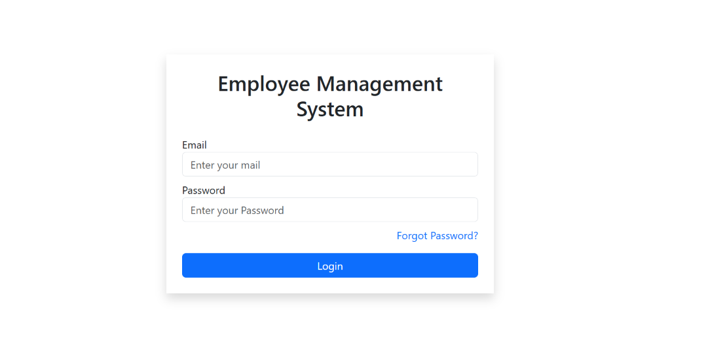
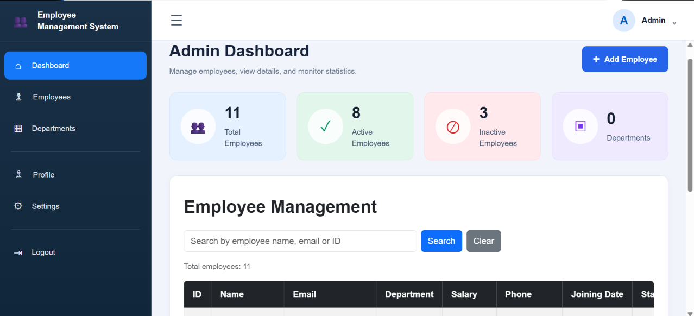
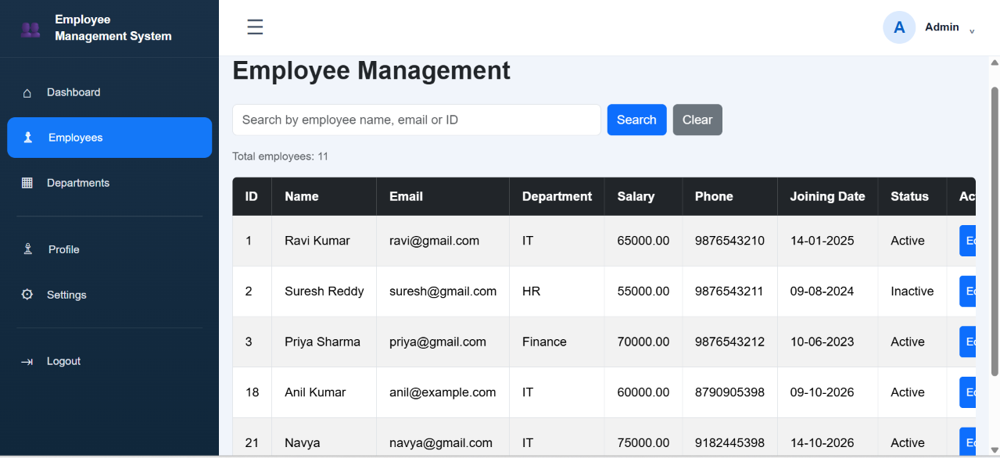
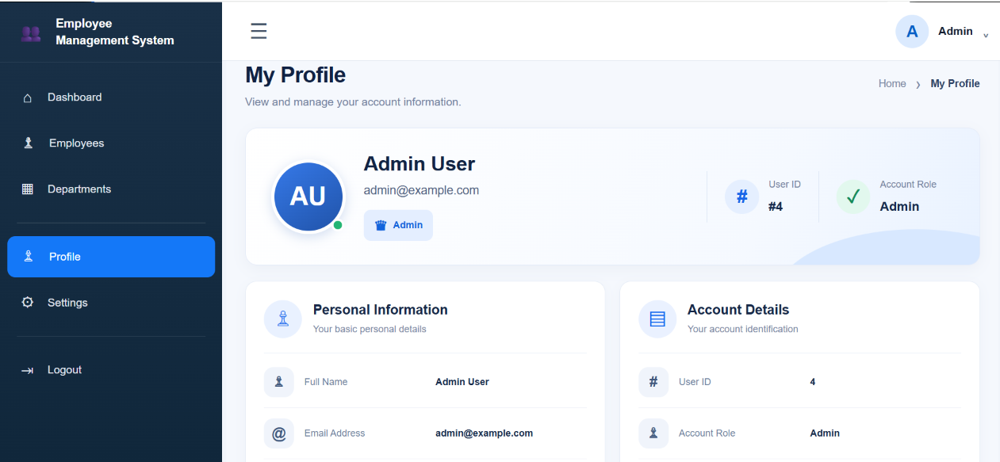
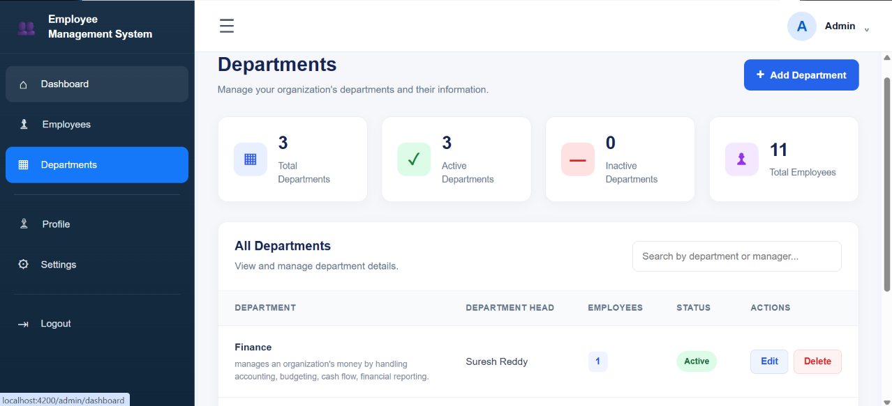
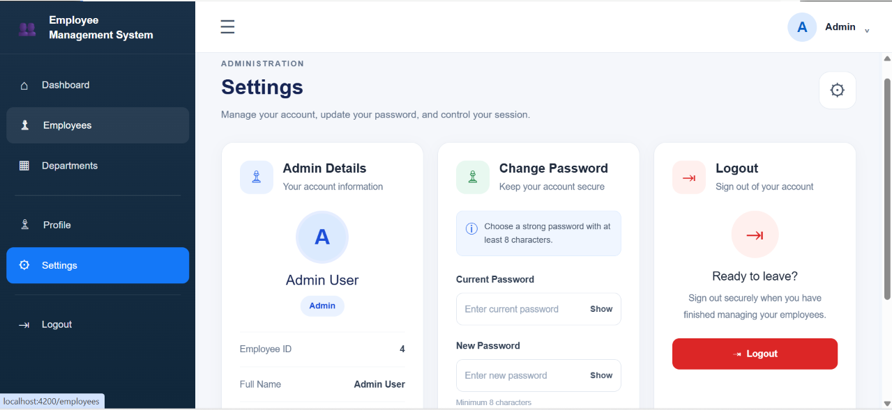
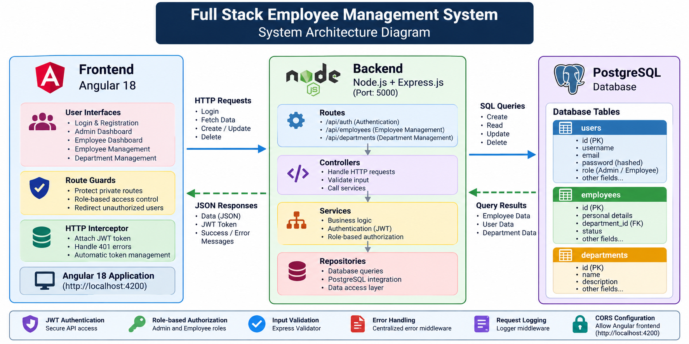

# Employee Management System (EMS)

A full-stack Employee Management System built using **Angular, Node.js, Express.js, and PostgreSQL**. The application provides role-based access for administrators and employees, with authentication, employee management, department management, and password management features.

## 🚀 Features

### Admin
- Secure admin login.
- Admin dashboard.
- Add and manage employees.
- View employee details.
- Manage departments.
- Employee search and pagination.
- Role-based access control.

### Employee
- Secure employee login.
- View personal profile.
- Access employee dashboard.
- Change password.
- Forgot password and reset password functionality.

### Authentication & Security
- JWT-based authentication.
- Password hashing.
- Authentication guards and role guards.
- HTTP authentication interceptor.
- Backend authentication and validation middleware.
- Password setup and reset flow.

## 🛠️ Technology Stack

| Technology | Purpose |
|---|---|
| Angular 18 | Frontend |
| TypeScript | Frontend programming |
| HTML5, CSS3 | UI development |
| Node.js | Backend runtime |
| Express.js | REST API development |
| PostgreSQL | Database |
| JWT | Authentication |
| Git & GitHub | Version control |

## 📁 Project Structure

```text
FullStack-Employee-Management-System/
│
├── backend/
│   ├── config/
│   ├── controllers/
│   ├── middleware/
│   ├── repositories/
│   ├── routes/
│   ├── scripts/
│   ├── services/
│   ├── utils/
│   ├── package.json
│   └── server.js
│
├── frontend/
│   └── employee-frontend/
│       ├── public/
│       ├── src/
│       │   └── app/
│       │       ├── admin/
│       │       ├── auth/
│       │       ├── guards/
│       │       ├── interceptors/
│       │       ├── layouts/
│       │       ├── models/
│       │       ├── pages/
│       │       └── services/
│       ├── angular.json
│       └── package.json
│
├── .gitignore
└── README.md
```

## ⚙️ Installation and Setup

### 1. Clone the Repository

```bash
git clone https://github.com/anil-kumar8790/FullStack-Employee-Management-System.git
```

### 2. Backend Setup

Navigate to the backend folder:

```bash
cd FullStack-Employee-Management-System/backend
```

Install dependencies:

```bash
npm install
```

Create a `.env` file inside the backend folder and configure your environment variables.

Example:

```env
PORT=5000
DB_HOST=localhost
DB_PORT=5432
DB_NAME=your_database
DB_USER=your_username
DB_PASSWORD=your_password
JWT_SECRET=your_secret_key
```

Add any additional environment variables required by your backend email configuration.

Start the backend server using the start script defined in `backend/package.json`:

```bash
npm start
```

### 3. Frontend Setup

Open another terminal and navigate to:

```bash
cd FullStack-Employee-Management-System/frontend/employee-frontend
```

Install dependencies:

```bash
npm install
```

Start the Angular application:

```bash
ng serve
```

Open your browser:

```text
http://localhost:4200
```

## 🗄️ Database

This application uses PostgreSQL as its relational database.

Before running the application:

1. Install and start PostgreSQL.
2. Create the application database.
3. Configure the database credentials in the backend `.env` file.
4. Set up the required database tables and schema.

## 🔐 Security Notes

- Never commit `.env` files or actual credentials.
- Use strong JWT secrets.
- Store passwords securely using hashing.
- Keep backend authorization checks enabled.
- Validate all incoming API requests.

## 💻 GitHub Repository

[Full Stack Employee Management System](https://github.com/anil-kumar8790/FullStack-Employee-Management-System)

## 👨‍💻 Author

**Anil Kumar**

Full Stack Developer | Angular | Node.js | Express.js | PostgreSQL

---

⭐ If you find this project useful, consider giving the repository a star!


## 📸 Application Screenshots

### 1. Login Page


### 2. Admin Dashboard


### 3. Employee List


### 4. Employee Profile


### 5. Department Management


### 6. Settings Management



## 🔗 API Documentation

### Authentication APIs

| Method | Endpoint | Description | Access |
|---|---|---|---|
| POST | `/register` | Register a new user | Public |
| POST | `/login` | Authenticate user and generate JWT | Public |
| POST | `/forgot-password` | Request password reset | Public |
| POST | `/reset-password` | Reset user password | Public |
| PUT | `/set-employee-password` | Set employee password | Admin |
| POST | `/complete-employee-password-setup` | Complete employee password setup | Public |
| PUT | `/change-password` | Change logged-in user's password | Authenticated |
| GET | `/profile` | Retrieve logged-in user's profile | Authenticated |

### Authentication and Authorization

- JWT-based authentication.
- Authentication middleware protects private endpoints.
- Role middleware restricts employee password setup to Admin users.
- Express Validator handles registration and login validation.
- Validation errors are returned with HTTP 400 status.

### Authentication Headers

For protected endpoints, provide the JWT token:

```http
Authorization: Bearer <your_jwt_token>
```

### HTTP Status Codes

- `200` – Successful request.
- `400` – Validation error or invalid request.
- `401` – Unauthorized request.
- `403` – Forbidden access.
- `500` – Internal server error.


### Employee Management APIs

| Method | Endpoint | Description | Access |
|---|---|---|---|
| GET | `/employees` | Retrieve all employees | Authenticated |
| GET | `/employees/me` | Retrieve logged-in employee profile | Authenticated |
| GET | `/employees/stats` | Retrieve employee status counts | Admin |
| GET | `/employees/:id` | Retrieve employee by ID | Admin / Employee |
| POST | `/employees` | Create a new employee | Admin |
| PUT | `/employees/:id` | Update employee details | Admin |
| DELETE | `/employees/:id` | Delete an employee | Admin |

### Employee API Features

- Employee listing with pagination.
- Department-based filtering.
- Sorting support.
- Employee profile retrieval.
- Employee status statistics.
- Employee creation, updating, and deletion.
- Request validation using Express Validator.
- JWT authentication and role-based access control.


### Department Management APIs

| Method | Endpoint | Description |
|---|---|---|
| GET | `/departments` | Retrieve all departments |
| POST | `/departments` | Create a new department |
| PUT | `/departments/:id` | Update department details |
| DELETE | `/departments/:id` | Delete a department |

### Department API Features

- Retrieve all departments.
- Create new departments.
- Update existing department details.
- Delete departments.

## 🔗 REST API Documentation

### Base URL

```text
http://localhost:5000/api
```

### Authentication APIs

| Method | Endpoint | Description |
|---|---|---|
| POST | `/auth/register` | Register a new user |
| POST | `/auth/login` | Authenticate user |
| POST | `/auth/forgot-password` | Request password reset |
| POST | `/auth/reset-password` | Reset password |
| PUT | `/auth/set-employee-password` | Admin sets employee password |
| POST | `/auth/complete-employee-password-setup` | Complete employee password setup |
| PUT | `/auth/change-password` | Change logged-in user's password |
| GET | `/auth/profile` | Retrieve logged-in user's profile |

### Employee Management APIs

| Method | Endpoint | Description | Access |
|---|---|---|---|
| GET | `/employees` | Retrieve all employees | Authenticated |
| GET | `/employees/me` | Retrieve logged-in employee profile | Authenticated |
| GET | `/employees/stats` | Retrieve employee status counts | Admin |
| GET | `/employees/:id` | Retrieve employee by ID | Admin / Employee |
| POST | `/employees` | Create employee | Admin |
| PUT | `/employees/:id` | Update employee | Admin |
| DELETE | `/employees/:id` | Delete employee | Admin |

### Department Management APIs

| Method | Endpoint | Description |
|---|---|---|
| GET | `/departments` | Retrieve all departments |
| POST | `/departments` | Create department |
| PUT | `/departments/:id` | Update department |
| DELETE | `/departments/:id` | Delete department |

### Security

- JWT-based authentication.
- Role-based authorization for employee management.
- Express Validator for registration and login validation.
- Request validation middleware.
- Centralized error handling.

### Backend Configuration

- Backend framework: Express.js
- Server port: 5000
- Database: PostgreSQL
- Frontend origin allowed by CORS: `http://localhost:4200`

### Run the Backend

```bash
cd backend
npm install
npm start
```

### Run the Frontend

```bash
cd frontend/employee-frontend
npm install
ng serve
```

Open the application at:

http://localhost:4200


## 🏗️ System Architecture

The application follows a three-tier architecture:

1. **Frontend:** Angular 18 handles user interfaces, routing, authentication guards and API communication.
2. **Backend:** Node.js and Express.js provide REST APIs, business logic, validation and authorization.
3. **Database:** PostgreSQL stores user, employee and department information.

### Architecture Diagram

